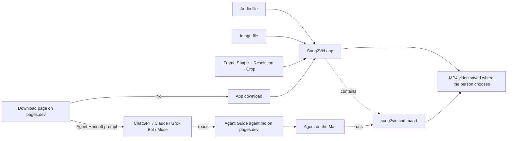

# Song2Vid — Project brief

## What it is

Song2Vid is a Mac desktop app. You give it one audio file and one image file, pick a **Frame Shape** and **Resolution**, and it makes a video: the image stays on screen for the whole song. A small download page on Cloudflare Pages (`*.pages.dev`) lets other people download the app and read short instructions.

The project is also a public demonstration of building with AI using the Starter Pack and the Grill to Build planning process. The plan files, `docs/agents/`, the wiki in `docs/wiki/`, and the agent skills in `.claude/skills/` are public on purpose, so someone can see the whole setup or start from this point themselves.

## Who it is for

The owner, plus anyone who finds the download page. The app is not signed with a paid Apple Developer ID, so the download page tells people how to open it the first time (right-click → Open).

## Agreed so far

- Name: **Song2Vid**. Source repository: `song2vid-app` on GitHub, **fully public**, including these plan files (ADR-004).
- Platform: native macOS app (ADR-001), Apple silicon.
- One song at a time: choose or drag in an audio file and an image, choose options, make the video, choose where to save it.
- **Drag and drop is required.** Drop a song, an image, or both. If a slot is already filled, a dialog asks to Replace or Keep Current (the safe default) before anything changes.
- Song2Vid has its own original icon, showing a song becoming a video, also used on the download page.
- **Frame Shapes:** 16:9, 9:16, 1:1 (square), 4:3, and Original (the image's own exact dimensions).
- **Resolutions:** 480p, 1080p, 2160p, available for every Frame Shape except Original. "p" is the short side of the frame (see `GLOSSARY.md`):

  | Frame Shape | 480p | 1080p | 2160p |
  | --- | --- | --- | --- |
  | 16:9 | 854×480 | 1920×1080 | 3840×2160 |
  | 9:16 | 480×854 | 1080×1920 | 2160×3840 |
  | 1:1 | 480×480 | 1080×1080 | 2160×2160 |
  | 4:3 | 640×480 | 1440×1080 | 2880×2160 |

- **Fit with bars** for 16:9 and 9:16: the whole image is shown, scaled to fit, with black bars filling the rest.
- **Crop** for 1:1 and 4:3: the image fills the frame, and the person drags the image in a live preview to choose which part is kept. It starts centered.
- **Enlarging:** if the image is smaller than the chosen Resolution, it is enlarged anyway and a short note says so.
- **Original sizing:** the image's exact shape, kept within 4K (3840×2160 wide, 2160×3840 tall). A larger image is scaled down. If it is less than 1% too big, a few edge pixels are trimmed instead of scaling, which keeps it sharp. Odd pixel sizes lose one pixel, because video needs even sizes.
- Download page: minimal, with a download link and brief instructions only. Address `song2vid.pages.dev`, falling back to `song2vid-app.pages.dev`. Hosted on the same Cloudflare account as the earlier `stock-example` and `beat2vid` projects. If the name is held by one of the owner's own older projects, that page may be replaced (the owner confirms at deploy time).
- Commits show the owner's own name and GitHub account, not Claude or a bot (ADR-007).
- Public-from-day-one rules (ADR-003).

## Phase 3: make Song2Vid usable by agents (discovery open)

Started 2026-11-21. Goal: an agent can make a Song2Vid video for someone, and people can hand that job to the agent they already use. This is the Starter Pack Phase 3 **agent-cli** level, extending this Phase 2 build.

Agreed so far (round 1):

- **Command:** a `song2vid` command-line tool that calls `Song2VidCore`, with no copied logic. It ships **inside Song2Vid.app** (ADR-013); the person or their agent links it onto the PATH. Release **1.1.0**, which also removes the leftover debugging permission while keeping the app sandbox.
- **Existing files:** `song2vid make` never replaces an existing output unless `--overwrite` is given, and `--dry-run` reports the output size and placement without writing anything (ADR-014). The person's audio and image files are never changed.
- **Agent skill:** written with the `writing-for-agents` skill, kept at `skills/song2vid/SKILL.md`, and served publicly as the **Agent Guide** at `song2vid.pages.dev/agent.md` (ADR-015).
- **Agent Handoff:** on the download page, for **ChatGPT, Claude, Grok Bot and Muse** (Meta's personal agent). Claude Code and Codex are not on it (ADR-016). All four marks are authentic and must be shown; none may be skipped (Muse and Grok Bot artwork sources are in ADR-016). The prompt is simple and non-technical: it asks the agent to use Song2Vid to make a video from a song and an image, and points at the Agent Guide. The agent decides whether to use the app's window or the command (ADR-017).
- **Agent Guide** covers both routes: the app's window, for agents that operate apps, and the command, for agents with a terminal.
- **Docs page:** a human documentation page on the download site (`song2vid.pages.dev/docs`) for people who use the command directly.
- **Commands (first version):** `song2vid check` (read-only: song length, image size, and the output size for each Frame Shape) and `song2vid make`. Options also include `--help`, `--version`, `--skill` (prints the agent skill), `--repo` (prints the source repo link) and `--update` if it is easy. **Every option has a one-letter short form.**
- **Progress is always visible (ADR-018).** Nobody should wait on something that seems stalled. In a terminal (headed), a live progress bar with stage, percent, elapsed time and time left; a moving indicator while the percent is not known yet. Headless (agents, scripts), the same progress is available in machine-readable form while the run is going, so an agent can check on it mid-run. Everything the command does works headless.
- **Test media:** test videos are made from the owner's sample files outside the repo (ADR-012); they are never committed.
- **Workflow:** same as Phase 2: Grill to Build, the chief-of-staff workflow with Sonnet builders, commits as `devin`, tests on this Mac.
- **Phase 3 proof:** a new Claude Code session that has never seen the project runs the installed command, makes a video, and hits one deliberate failure; the owner confirms. This is separate from the handoff's agent list.

## Not in scope

- Several songs at once, editing tools, Windows. Parked in `Ideas.md` as update ideas.
- Paid Apple signing (ADR-005).

## Open questions

Phase 3, round 3:

8. How an agent reads progress during a headless run.
9. What `--update` does.
10. The one-letter short forms.

## Discovery progress

- Workflow: Grill to Build (default).
- Phase 2: 3 of 5 rounds, 10 of 20 questions. Discovery closed; plan approved 2026-11-18.
- Phase 3: 2 of 5 rounds, 7 of 20 questions. Discovery open.
- **Plan approved 2026-11-18**, with changes: drag and drop (with the replace dialog) and an app icon were added.
- **Build workflow:** the owner asked for Matt Pocock's `chief-of-staff` skill, installed in this repo under `.claude/skills/`. Opus coordinates, verifies and writes the docs. Sonnet subagents on high reasoning build each ticket.

## System model

