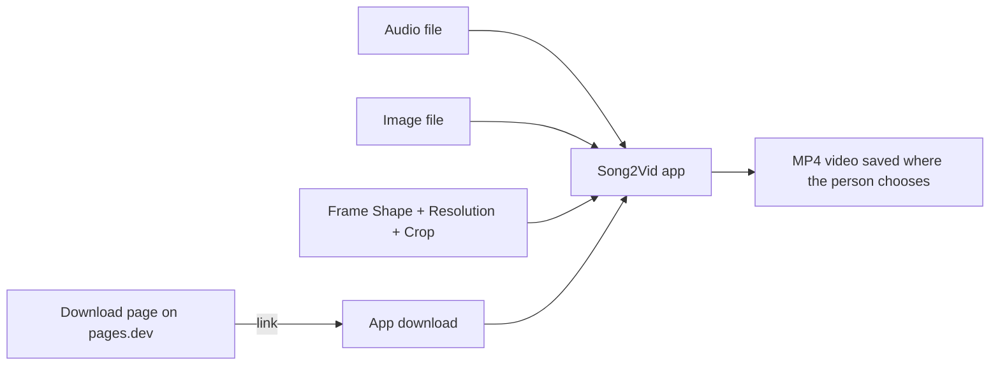

# Song2Vid — Project brief

## What it is

Song2Vid is a Mac desktop app. You give it one audio file and one image file, pick a **Frame Shape** and **Resolution**, and it makes a video: the image stays on screen for the whole song. A small download page on Cloudflare Pages (`*.pages.dev`) lets other people download the app and read short instructions.

The project is also a public teaching example: the plan files in this repo show how a project like this is planned with Grill to Build, so others can follow the same process.

## Who it is for

The owner, plus anyone who finds the download page. The app is not signed with a paid Apple Developer ID, so the download page tells people how to open it the first time (right-click → Open).

## Agreed so far

- Name: **Song2Vid**. Source repository: `song2vid-app` on GitHub, **fully public**, including these plan files (ADR-004).
- Platform: native macOS app (ADR-001), Apple silicon.
- One song at a time: choose or drag in an audio file and an image, choose options, make the video, choose where to save it.
- **Drag and drop is required.** Drop a song, an image, or both. If a slot is already filled, a dialog asks to Replace or Keep Current (the safe default) before anything changes.
- Song2Vid has its own original icon, showing a song becoming a video, also used on the download page.
- **Frame Shapes:** 16:9, 9:16, 1:1 (square), 4:3, and Original (the image's own exact dimensions).
- **Resolutions:** 480p, 1080p, 2160p, available for every Frame Shape except Original. "p" is the short side of the frame (see `GLOSSARY.md`):

  | Frame Shape | 480p | 1080p | 2160p |
  | --- | --- | --- | --- |
  | 16:9 | 854×480 | 1920×1080 | 3840×2160 |
  | 9:16 | 480×854 | 1080×1920 | 2160×3840 |
  | 1:1 | 480×480 | 1080×1080 | 2160×2160 |
  | 4:3 | 640×480 | 1440×1080 | 2880×2160 |

- **Fit with bars** for 16:9 and 9:16: the whole image is shown, scaled to fit, with black bars filling the rest.
- **Crop** for 1:1 and 4:3: the image fills the frame, and the person drags the image in a live preview to choose which part is kept. It starts centered.
- **Enlarging:** if the image is smaller than the chosen Resolution, it is enlarged anyway and a short note says so.
- **Original sizing:** the image's exact shape, kept within 4K (3840×2160 wide, 2160×3840 tall). A larger image is scaled down. If it is less than 1% too big, a few edge pixels are trimmed instead of scaling, which keeps it sharp. Odd pixel sizes lose one pixel, because video needs even sizes.
- Download page: minimal, with a download link and brief instructions only. Address `song2vid.pages.dev`, falling back to `song2vid-app.pages.dev`. Hosted on the same Cloudflare account as the earlier `stock-example` and `beat2vid` projects. If the name is held by one of the owner's own older projects, that page may be replaced (the owner confirms at deploy time).
- Commits show the owner's own name and GitHub account, not Claude or a bot (ADR-007).
- Public-from-day-one rules (ADR-003).

## Not in scope

- Several songs at once, editing tools, Windows. Parked in `Ideas.md` as update ideas.
- Paid Apple signing (ADR-005).

## Open questions

None. Round 3 answers: commits are authored as `devin` with the GitHub noreply address; licence is MIT.

## Discovery progress

- Workflow: Grill to Build (default).
- Rounds used: 3 of 5. Questions asked: 10 of 20. Discovery closed.
- **Plan approved 2026-11-18**, with changes: drag and drop (with the replace dialog) and an app icon were added.
- **Build workflow:** the owner asked for Matt Pocock's `chief-of-staff` skill, installed in this repo under `.claude/skills/`. Opus coordinates, verifies and writes the docs. Sonnet subagents on high reasoning build each ticket.

## System model

